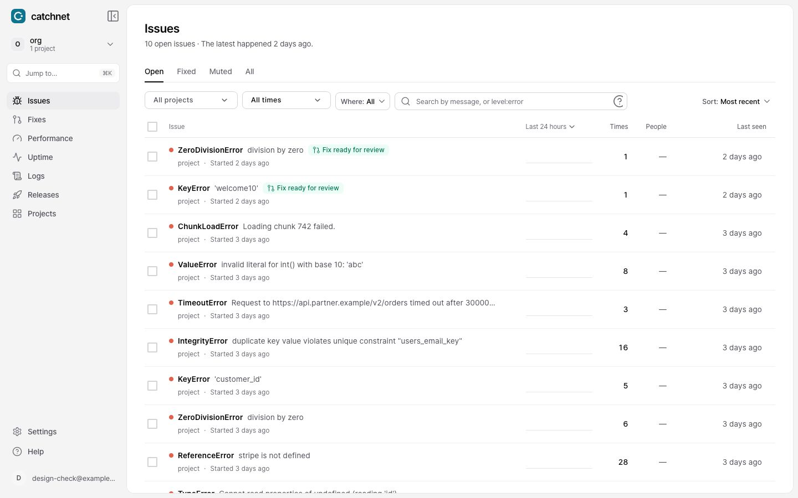
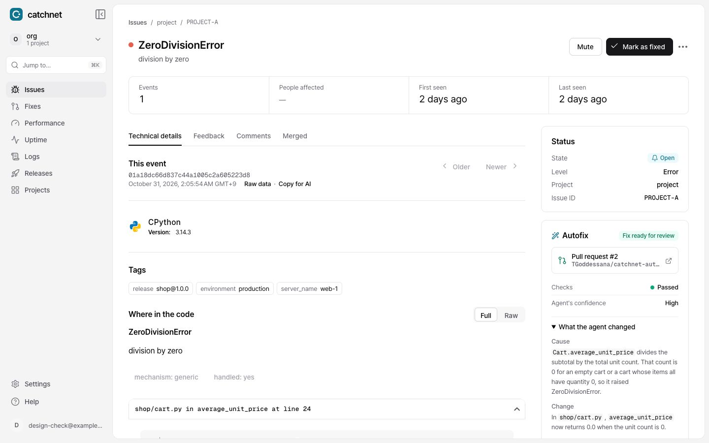
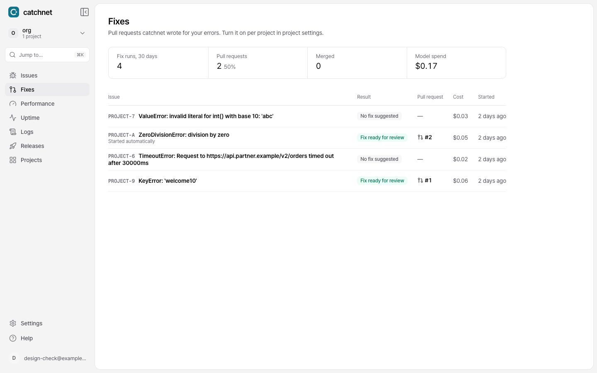
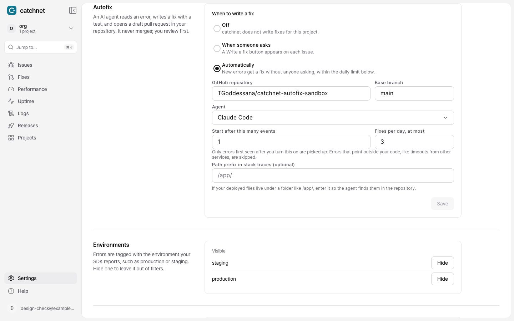

# catchnet

catchnet is an error tracker built on [GlitchTip](https://glitchtip.com): GlitchTip's backend and API with a redesigned frontend. The goal beyond the redesign is that catchnet goes from an incoming issue to a pull request that fixes it.

## Screenshots

**Issues.** Errors that already have a fix waiting show it in the list.

**Autofix on an issue.** catchnet read the error, wrote a fix with a test and opened a draft pull request. CI passed; the panel shows the cause and the change.

**Fixes.** Every fix run in the organization, with its result, pull request and cost.

**Project settings.** Off, on request, or automatic, with a daily limit. See [docs/autofix.md](docs/autofix.md) for how it works.

## Layout

| Folder | What it is | Upstream |
| --- | --- | --- |
| `frontend/` | The Angular app (the catchnet redesign) | [glitchtip-frontend](https://gitlab.com/glitchtip/glitchtip-frontend) |
| `backend/` | The Django backend and API | [glitchtip-backend](https://gitlab.com/glitchtip/glitchtip-backend) |
| `runner/` | The autofix runner: turns an issue into a draft pull request | catchnet only |
| `tools/` | Screen-capture and seed scripts, the autofix benchmark | catchnet only |
| `docs/` | The autofix design and results | catchnet only |
| `.claude/` | Claude Code launch configs and the design skill | catchnet only |

Both upstream projects are MIT licensed; each folder keeps its own `LICENSE`.

## Running it locally

1. Backend: `cd backend && docker compose up -d` serves the API on http://localhost:8000. The first run prints a seeded admin login in `docker compose logs web`.
2. Frontend: `cd frontend && npm ci && npm start` serves the app on http://localhost:4200 and proxies API calls to the backend. Angular needs Node 24.15 or newer.
3. Test events: `python3 tools/seed_events.py <dsn-key>`.

## Keeping up with GlitchTip

Each folder is a git subtree of its upstream project, so upstream changes come in per folder with their history. See [UPSTREAM.md](UPSTREAM.md).

## Design

The frontend follows three principles, written in [frontend/DESIGN.md](frontend/DESIGN.md).
